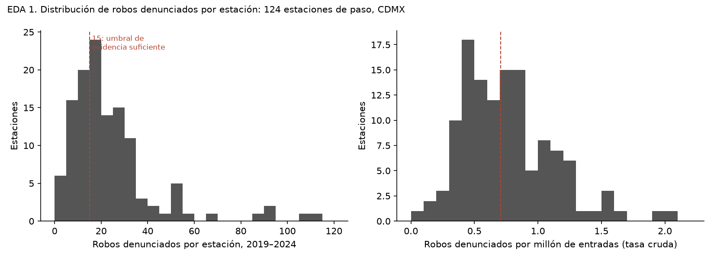
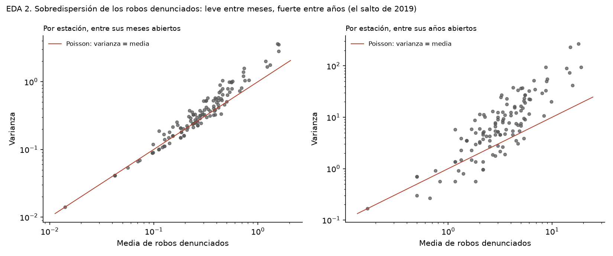
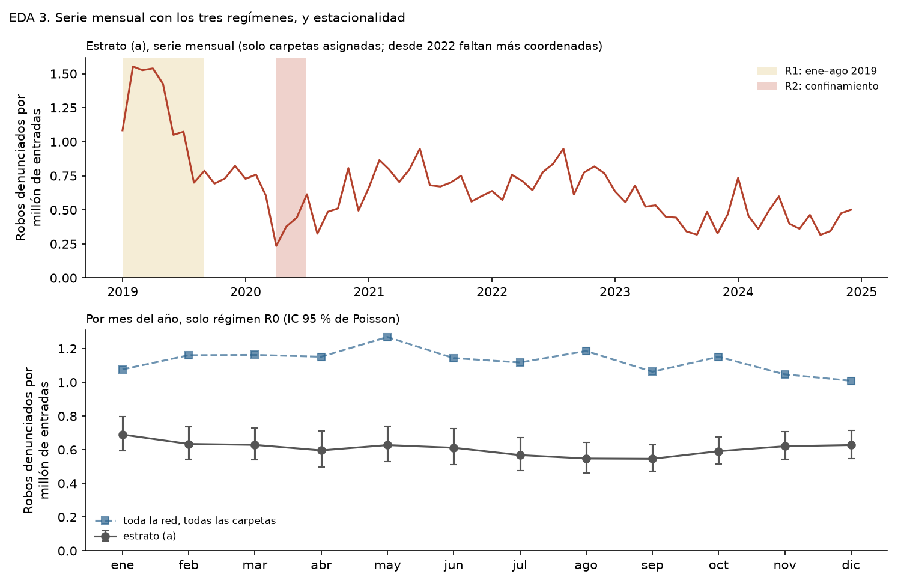
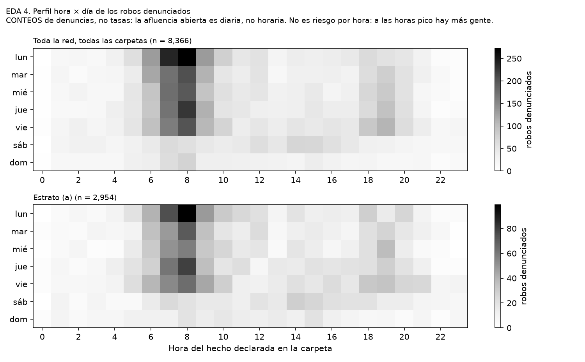
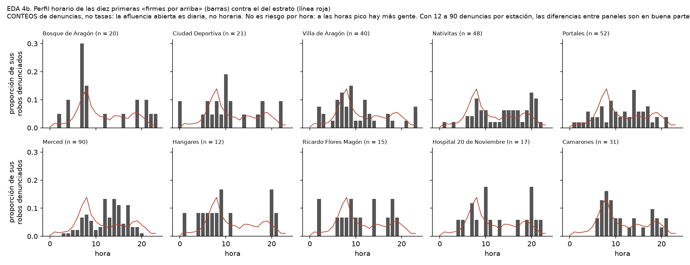
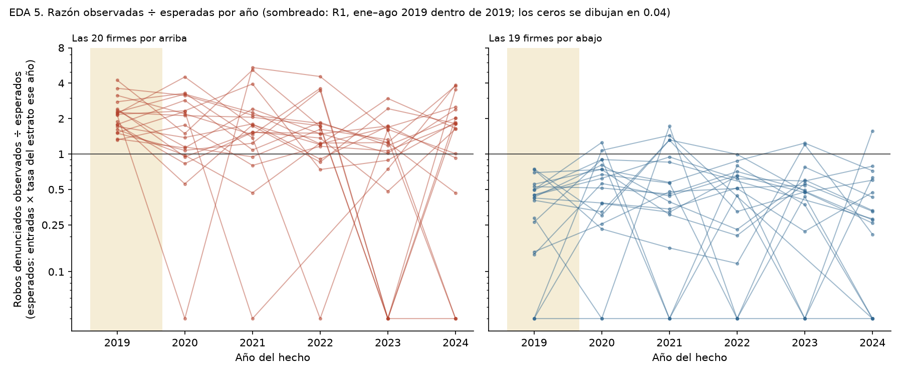

# EDA del estrato (a): 124 estaciones de paso de la CDMX, 2019–2024

*Corrido el 2026-09-20 con `python src/metro/07_eda.py`, **antes de ajustar ningún modelo**.
El numerador son DENUNCIAS (carpetas de la FGJ por «robo a pasajero a bordo de Metro», por
fecha del hecho). Tablas en `datos/procesados/metro_tablas/eda_*.csv`; figuras en
`docs/figuras/metro/eda_*.png`. Cada hallazgo cierra con la decisión de modelado que implica;
las hipótesis que de aquí salen están congeladas en [`hipotesis.md`](hipotesis.md), parte B.*

**Advertencias vigentes.** El 19.1 % de las carpetas no se asignó a estación (1,041 sin
coordenadas —715 de Denuncia Digital, concentradas en 2022–2024— y 559 a más de 150 m). Todo
lo que aquí es «por estación» supone que lo que falta, falta parejo entre estaciones. Por
eso las series del estrato desde 2022 están sesgadas a la baja.

**Los tres regímenes que C3 dejó establecidos**, marcados en toda serie temporal:

| Régimen | Meses | Robos denunciados (estrato) | Entradas (M) | `tasa_denuncias_mm` |
|---|---|---|---|---|
| **R1** enero–agosto de 2019 | 8 | 851 (29 %) | 689 | **1.24** |
| **R2** abril–junio de 2020, confinamiento | 3 | 26 (1 %) | 74 | **0.35** |
| **R0** el resto | 61 | 2,068 (70 %) | 3,408 | **0.61** |

## 1. Distribución de robos denunciados por estación

| | Mín. | p10 | p25 | Mediana | Media | p75 | p90 | Máx. |
|---|---|---|---|---|---|---|---|---|
| Robos denunciados por estación, seis años | 1 | 7 | 11 | **18** | 23.8 | 28 | 46 | 114 |

Asimétrica a la derecha, sin ceros. **La estación mediana tiene 18 denuncias en seis años:
tres al año.** 42 de las 124 tienen menos de 15. La concentración es moderada: las cinco
primeras reúnen el 16.8 % de las denuncias del estrato, las diez primeras el 26.5 %, y hace
falta la cuarta parte de las estaciones (31) para llegar a la mitad. Nada parecido a la
concentración de las correspondencias.

→ **Decisión de modelado:** con tres denuncias al año por estación, la tasa cruda de la
mayoría es casi puro ruido. Hace falta un modelo que **tome prestada información entre
estaciones** (efecto aleatorio `v_s`) en vez de estimar 124 tasas sueltas; y la unidad de
tiempo tiene que ser el año, no el mes. De aquí sale **M3**.

## 2. Sobredispersión: leve entre meses, fuerte entre años

| Nivel | Mediana de varianza ÷ media | % de estaciones con varianza > media | p90 |
|---|---|---|---|
| Estación × mes | 1.14 | 67.7 | 1.73 |
| Estación × año | **2.33** | 83.1 | 6.05 |
| Estación × mes, **sin R1 ni R2** | **1.00** | 51 | — |

Entre años, la varianza es más del doble de la media: la nube queda claramente arriba de la
recta de Poisson. **Pero casi toda esa sobredispersión es el cambio de régimen de 2019.**
Entre meses, quitando R1 y R2, la mediana de varianza ÷ media es 1.00 y solo la mitad de las
estaciones queda arriba de la recta: exactamente lo que daría una Poisson.

→ **Decisión de modelado:** esto **no** justifica la binomial negativa por sí solo. Justifica
poner un efecto de año `gamma_t` —que absorbe el salto de 2019— y, una vez puesto, **probar**
si queda sobredispersión, en vez de suponerla. La expectativa honesta, escrita antes de
ajustar, es que **M1 puede fallar** y que la Poisson con efecto de estación y de año puede
bastar. Se ajustan las dos y se decide con la prueba de razón de verosimilitudes y el AIC.

## 3. Serie mensual y estacionalidad

La serie mensual del estrato reproduce lo de C3: nivel alto en R1, hoyo en R2, y después una
meseta que baja despacio desde 2022 (en parte por las coordenadas que faltan). La
estacionalidad, medida solo en R0, es **débil**: la tasa de denuncias por mes del año va de
0.55 (agosto y septiembre, 0.90 × la media) a 0.69 (enero, 1.14 ×), y los intervalos de casi
todos los meses se traslapan. Enero es el único que se separa con claridad de
agosto–septiembre. La red completa, con todas las carpetas, tiene el mismo perfil.

→ **Decisión de modelado:** la estacionalidad no amerita un término propio; agregar por año
la promedia. Lo que sí importa es que **los años no están completos por igual**: una
estación cerrada parte del año solo aporta los meses abiertos, y `E_st` tiene que ser la suma
de las entradas de esos meses, no de doce. Así se construye el panel anual.

## 4. Perfil hora × día — CONTEOS, no tasas

> **Advertencia obligatoria.** La afluencia abierta del Metro es **diaria, no horaria**. Este
> perfil son CONTEOS de denuncias por hora declarada del hecho. **No es riesgo por hora:** a
> las horas pico hay muchas más personas en el sistema, y sin afluencia horaria no se puede
> saber si por pasajero se denuncia más o menos.

| | 6 a 9 h | 10 a 13 h | 14 a 17 h | 18 a 21 h | 22 a 5 h | Fin de semana |
|---|---|---|---|---|---|---|
| Estrato (a), % de sus **2,954** denuncias asignadas | **39.2** | 15.8 | 15.5 | 17.4 | 12.1 | 19.7 |

**Por qué aquí son 2,954 y en el resto del trabajo 2,945** (verificado el 2026-10-07 contra
`datos/procesados/panel_estacion.csv`). Las dos cifras están bien y cuentan cosas distintas.
Este perfil son CONTEOS y no necesita denominador, así que incluye **las 9 denuncias que
caen en 8 meses-estación con cero entradas**: Isabel La Católica (2023-11, 2024-02, 2024-04,
2024-07), Cuauhtémoc (2024-04, 2024-11), Insurgentes Sur (2022-06) —los cierres de la Línea
1— y Culhuacán (2021-06, Línea 12). Todo lo que lleva tasa las deja fuera, porque sin
afluencia no hay denominador (decisión 8): la tabla de regímenes de arriba, la sección 1, la
fase 2, la fase 3 y el modelo trabajan sobre **2,945**. Los dos perfiles horarios (4 y 4b,
«19.7 % del estrato» incluido) son los únicos que usan 2,954.

Cuatro de cada diez denuncias del estrato declaran un hecho entre las 6 y las 9 de la mañana;
lunes (18.3 %) y viernes (18.1 %) son los días con más, domingo (8.2 %) el de menos. **La
hora declarada está redondeada:** el 32 % de las carpetas da la hora en punto y el 57 % un
minuto múltiplo de 30; solo el 1.5 % cae en las 12:00 exactas, así que no hay una hora «por
defecto» que ensucie el perfil.

Entre las diez primeras firmes por arriba hay perfiles distintos —Merced tiene 40 % de sus
denuncias en fin de semana contra 19.7 % del estrato; Nativitas y Hospital 20 de Noviembre
cargan a la tarde (31 y 29 % entre 18 y 21 h contra 17.4 %); Villa de Aragón, Bosque de
Aragón y Camarones, a la mañana (45 a 48 %)—, pero con 12 a 90 denuncias por estación la
mayor parte de esas diferencias es ruido. Solo Merced (90 denuncias) tiene tamaño para
sostener la suya.

→ **Decisión de modelado:** la hora **no entra al modelo**: no hay denominador horario y
meterla sería modelar conteos como si fueran riesgo. El perfil queda como descripción para
quien decide la franja del despliegue, siempre con la advertencia encima.

## 5. ¿Las 39 firmes lo son de forma estable, o las pone ahí un año?

Razón de robos denunciados observados ÷ esperados por año (esperados = entradas de la
estación ese año × tasa del estrato ese año), y la prueba que importa: **quitando un año a
la vez, ¿la estación sigue distinguiéndose del estrato?**

| | Firmes (fase 3) | **Siguen firmes quitando CUALQUIER año** |
|---|---|---|
| Por arriba | 20 | **9**: Bosque de Aragón, Ciudad Deportiva, Villa de Aragón, Nativitas, Portales, Merced, Zócalo/Tenochtitlan, Etiopía, Insurgentes |
| Por abajo | 19 | **10**: Obrera, Aculco, Autobuses del Norte, Politécnico, Universidad, Observatorio, Ferrería, Santa Marta, Escuadrón 201, Chapultepec |

**La mitad de las 39 depende de un año.** Las razones anuales de una misma estación saltan
mucho —Bosque de Aragón: 4.24, 1.49, 5.18, 1.71, 0.00, 3.54—, como corresponde a tres o
cuatro denuncias al año. En las firmes por arriba, **2019 pesa de más**: el año con más
denuncias aporta entre el 35 y el 57 % del total de cada una, y en 19 de las 20 ese año es 2019 (R1).
Las que aguantan son las que están del mismo lado cinco o seis años de seis (Portales, seis
de seis; Zócalo, seis de seis). Entre las de abajo, Tasqueña —séptima por conteo y el
ejemplo más citado de la fase 3— **no** aguanta: deja de distinguirse al quitar un año.
Tabla completa: `eda_estabilidad_firmes.csv`.

→ **Decisión de modelado:** esto es la multiplicidad a la vista: 39 «distinguibles» con
pruebas una por una, de las que 19 sobreviven a una perturbación mínima. El modelo tiene que
**encoger hacia la media en proporción a la poca evidencia** (eso hace `v_s`), con el año
descontado (`gamma_t`), y la vara para juzgarlo es que conserve a la mayoría de estas 19 y
deje fuera a buena parte de las otras 20. De aquí sale **M4**; y la inestabilidad anual fija
la expectativa modesta de **M5**.

## 6. Sensibilidad por estación al umbral de asignación

Antes solo se había medido agregada. Por estación, para las 39, con 100, 150 y 250 m
(`eda_sensibilidad_umbral_por_estacion.csv`):

- **36 de las 39 conservan su estatus con los tres umbrales** (17 de 20 por arriba, 19 de 19
  por abajo). Las tres que no —**Hangares, Juárez y Villa de Cortés**— dejan de distinguirse
  a 100 m: son de las que rozaban el límite (11, 27 y 26 denuncias a 100 m).
- Para casi todas, pasar de 100 a 250 m cambia el numerador menos de 15 %. **La excepción
  grande es Tasqueña: 42 denuncias a 100 m, 59 a 150 m, 65 a 250 m (+55 %)**, y su razón va
  de 0.54 a 0.77. Es una terminal con paradero: sus carpetas caen dispersas alrededor. Le
  siguen Chapultepec (+30 %) y Autobuses del Norte (+29 %, de 7 a 9).
- **Robustas a las dos pruebas (cualquier año y los tres umbrales): 19**, las mismas de la
  sección 5 —ninguna de las que aguantan el año falla por el umbral.

→ **Decisión de modelado:** el umbral de 150 m se queda; no hay que llevar la distancia al
modelo. Pero la tabla final debe **marcar a Tasqueña** como sensible a la asignación, y las
19 robustas son la lista contra la que se juzga el modelo (M4).

## Resumen de lo que el EDA le pide al modelo

| Hallazgo | Implicación |
|---|---|
| Mediana de 18 denuncias por estación en seis años | Efecto aleatorio de estación; panel anual, no mensual |
| La sobredispersión entre años es sobre todo el salto de 2019 | Efecto de año; **probar** NB contra Poisson, sin suponer |
| Estacionalidad débil; años incompletos por cierres | Sin término estacional; `E_st` = entradas de los meses abiertos |
| Perfil horario sin denominador | La hora no entra; se describe con advertencia |
| Solo 19 de 39 firmes aguantan quitar un año | Encogimiento jerárquico como respuesta a la multiplicidad |
| Tres estaciones sensibles al umbral; Tasqueña, mucho | 150 m se queda; Tasqueña va marcada |
| R2 es otro régimen (tasa 0.35 contra 0.61) | Excluir abril–junio de 2020; incluirlo como robustez |
