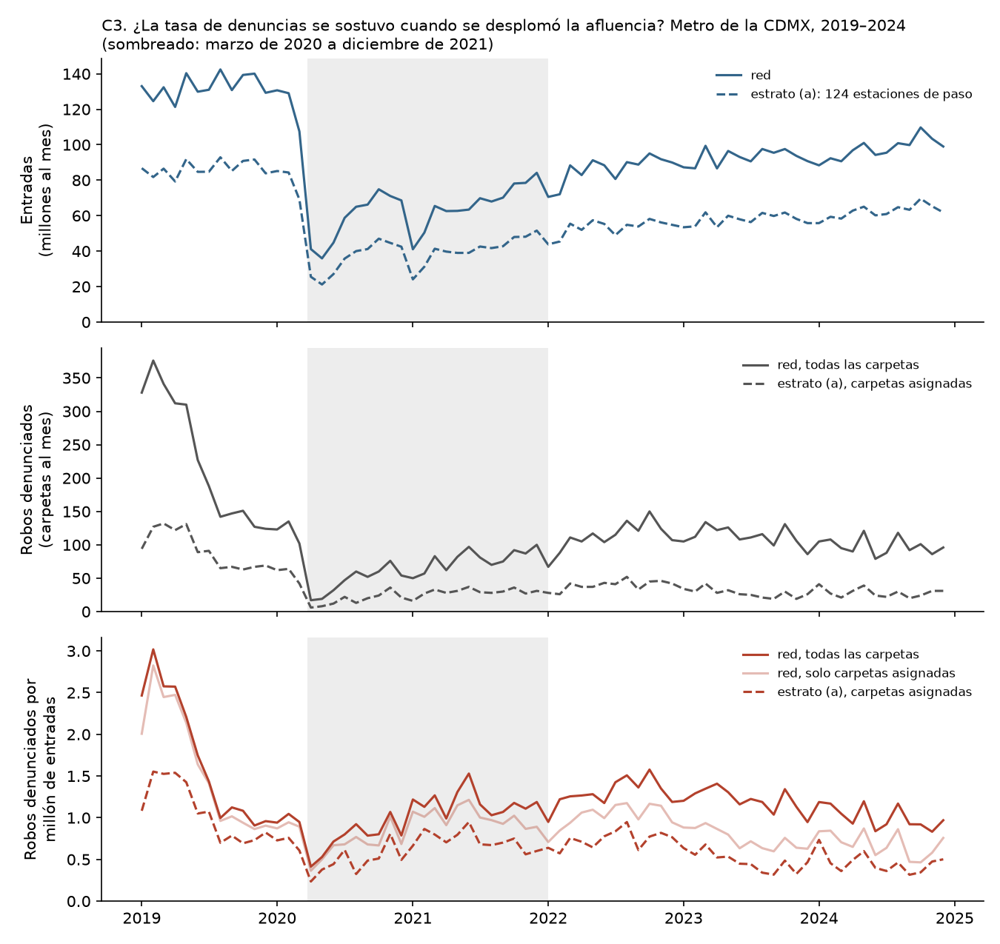

# Fase 3, compuerta T5 — ¿en las estaciones de paso el conteo y la tasa ordenan distinto?

*Corrido el 2026-09-20 con `python src/metro/correr.py` (paso `05_estrato_paso.py`). Sin
modelo. El numerador son DENUNCIAS: carpetas de la FGJ de «robo a pasajero a bordo de
Metro», por fecha del hecho, 2019–2024. Decisiones 24 a 30 en [`decisiones.md`](decisiones.md).*

**Resultado: T5 PASA, con holgura y de forma estable.** Spearman conteo–tasa de 0.45 y tres
coincidencias en el top-10, contra un criterio de falla de ≥ 0.9 **y** ≥ 9. **C3:** por el
criterio fijado antes de correr (contra 2019) la exposición lineal *no* se sostiene, pero la
gráfica muestra que ese criterio estaba mal planteado; contra una base prepandemia sí se
sostiene fuera del confinamiento estricto. Las dos lecturas van abajo.

**Una corrección:** el estrato (a) tiene **124 estaciones, no 123**. El 123 de la fase 2b
era la referencia de T1, que dejaba fuera a Observatorio por ser la estación bajo prueba;
sin filtro de agencia, Observatorio entra. Son las 135 sin correspondencia menos las 11 del
Estado de México.

**Advertencias vigentes, donde pegan:** el 19.1 % de las carpetas no se asignó a estación
(1,041 sin coordenadas —715 de ellas de Denuncia Digital, concentradas en 2022–2024— y 559
a más de 150 m). El ranking por estación supone que lo que falta, falta parejo entre
estaciones; eso no se ha verificado. En C3, la serie de la red usa todas las carpetas y no
sufre ese problema; la del estrato solo puede usar las asignadas y desde 2022 está sesgada
a la baja.

## 1. El criterio

Estrato (a): 124 estaciones, **2,945 robos denunciados y 4,170 millones de entradas**; tasa
conjunta de **0.71 por millón de entradas**.

| Umbral de asignación | Mínimo de robos denunciados | Estaciones | Robos denunciados | Tasa del estrato | Spearman conteo–tasa | Coincidencias top-10 | ¿Falla? |
|---|---|---|---|---|---|---|---|
| **150 m** | **0** | **124** | **2,945** | **0.71** | **0.454** | **3** | **No** |
| 150 m | 20 | 58 | 2,167 | 0.78 | 0.288 | 3 | No |
| 150 m | 30 | 29 | 1,467 | 0.88 | 0.152 | 5 | No |
| 100 m | 0 | 124 | 2,825 | 0.68 | 0.457 | 2 | No |
| 100 m | 20 | 55 | 2,027 | 0.76 | 0.237 | 4 | No |
| 100 m | 30 | 26 | 1,317 | 0.85 | 0.097 | 5 | No |
| 250 m | 0 | 124 | 3,070 | 0.74 | 0.439 | 2 | No |
| 250 m | 20 | 60 | 2,299 | 0.81 | 0.308 | 3 | No |
| 250 m | 30 | 34 | 1,664 | 0.86 | 0.336 | 5 | No |

No falla en ninguna de las nueve combinaciones. Al exigir más señal la correlación *baja*:
entre las estaciones con denuncias suficientes, conteo y tasa se parecen todavía menos. El
desacuerdo no depende de las estaciones chicas.

## 2. Top-15 por conteo y por tasa (150 m, sin mínimo)

«Se distingue» = el intervalo de Poisson al 95 % (Byar) de la tasa excluye la tasa del
estrato (0.71). Cambio positivo = sube al ordenar por tasa.

| Pos. conteo | Estación | Línea | Robos denunciados | Entradas (M) | `tasa_denuncias_mm` | IC 95 % | Pos. tasa | Cambio | ¿Se distingue? |
|---|---|---|---|---|---|---|---|---|---|
| 1 | Indios Verdes | 3 | 114 | 180.4 | 0.63 | 0.52–0.76 | 73 | −72 | no |
| 2 | Zócalo/Tenochtitlan | 2 | 108 | 83.5 | 1.29 | 1.06–1.56 | 10 | −8 | arriba |
| 3 | Constitución de 1917 | 8 | 94 | 170.6 | 0.55 | 0.45–0.67 | 82 | −79 | abajo |
| 4 | Merced | 1 | 90 | 56.8 | 1.59 | 1.27–1.95 | 4 | 0 | arriba |
| 5 | Buenavista | B | 88 | 97.6 | 0.90 | 0.72–1.11 | 34 | −29 | arriba |
| 6 | Insurgentes | 1 | 69 | 58.5 | 1.18 | 0.92–1.49 | 16 | −10 | arriba |
| 7 | Tasqueña | 2 | 59 | 113.5 | 0.52 | 0.40–0.67 | 90 | −83 | abajo |
| 8 | Polanco | 7 | 54 | 53.5 | 1.01 | 0.76–1.32 | 29 | −21 | arriba |
| 9 | Etiopía/Plaza de la Transparencia | 3 | 53 | 44.1 | 1.20 | 0.90–1.57 | 14 | −5 | arriba |
| 10 | Portales | 2 | 52 | 34.5 | 1.51 | 1.13–1.98 | 6 | +4 | arriba |
| 10 | Revolución | 2 | 52 | 45.6 | 1.14 | 0.85–1.49 | 20 | −10 | arriba |
| 12 | Chilpancingo | 9 | 50 | 71.3 | 0.70 | 0.52–0.92 | 64 | −52 | no |
| 13 | Nativitas | 2 | 48 | 31.7 | 1.52 | 1.12–2.01 | 5 | +8 | arriba |
| 14 | Miguel Ángel de Quevedo | 3 | 41 | 56.2 | 0.73 | 0.52–0.99 | 60 | −46 | no |
| 15 | Villa de Aragón | B | 40 | 24.8 | 1.61 | 1.15–2.19 | 3 | +12 | arriba |

| Pos. tasa | Estación | Línea | Robos denunciados | Entradas (M) | `tasa_denuncias_mm` | IC 95 % | Pos. conteo | Cambio | ¿Se distingue? |
|---|---|---|---|---|---|---|---|---|---|
| 1 | Bosque de Aragón | B | 20 | 9.6 | 2.08 | 1.27–3.21 | 55 | +54 | arriba |
| 2 | Ciudad Deportiva | 9 | 21 | 10.7 | 1.95 | 1.21–2.99 | 51 | +49 | arriba |
| 3 | Villa de Aragón | B | 40 | 24.8 | 1.61 | 1.15–2.19 | 15 | +12 | arriba |
| 4 | Merced | 1 | 90 | 56.8 | 1.59 | 1.27–1.95 | 4 | 0 | arriba |
| 5 | Nativitas | 2 | 48 | 31.7 | 1.52 | 1.12–2.01 | 13 | +8 | arriba |
| 6 | Portales | 2 | 52 | 34.5 | 1.51 | 1.13–1.98 | 10 | +4 | arriba |
| 7 | Hangares | 5 | 12 | 8.5 | 1.41 | 0.73–2.46 | 91 | +84 | arriba |
| 8 | Tlaltenco | 12 | 5 | 3.6 | 1.37 | 0.44–3.20 | 117 | +109 | **no** |
| 9 | Ricardo Flores Magón | B | 15 | 11.6 | 1.30 | 0.73–2.14 | 77 | +68 | arriba |
| 10 | Zócalo/Tenochtitlan | 2 | 108 | 83.5 | 1.29 | 1.06–1.56 | 2 | −8 | arriba |
| 11 | Camarones | 7 | 31 | 24.0 | 1.29 | 0.88–1.83 | 25 | +14 | arriba |
| 12 | Hospital 20 de Noviembre | 12 | 17 | 13.3 | 1.28 | 0.74–2.04 | 67 | +55 | arriba |
| 13 | Moctezuma | 1 | 32 | 26.0 | 1.23 | 0.84–1.74 | 22 | +9 | arriba |
| 14 | Etiopía/Plaza de la Transparencia | 3 | 53 | 44.1 | 1.20 | 0.90–1.57 | 9 | −5 | arriba |
| 15 | Parque de los Venados | 12 | 15 | 12.5 | 1.20 | 0.67–1.97 | 77 | +62 | **no** |

Ojo con la cabeza del orden por tasa: varias entran con 12 a 21 denuncias en seis años y
con un límite inferior del intervalo apenas por encima de 0.71 (Hangares 0.73, Ricardo
Flores Magón 0.73, Hospital 20 de Noviembre 0.74). Es evidencia delgada.

## 3 y 4. Las que más suben y las que más bajan

**Sin mínimo**, las diez que más **suben** son casi todas ruido: siete de diez no se
distinguen del estrato (Tlaltenco +109 con 5 denuncias; Valle Gómez +79 con 7; San Andrés
Tomatlán, Constituyentes, UAM Azcapotzalco, Lomas Estrella, Parque de los Venados). Se
sostienen Hangares (+84), Ricardo Flores Magón (+68) y Hospital 20 de Noviembre (+55), las
tres con el intervalo rozando la tasa del estrato.

Las diez que más **bajan** sí son señal: siete de diez se distinguen por abajo.

| Estación | Línea | Robos denunciados | Entradas (M) | `tasa_denuncias_mm` | IC 95 % | Pos. conteo → tasa | ¿Se distingue? |
|---|---|---|---|---|---|---|---|
| Universidad | 3 | 28 | 100.6 | 0.28 | 0.18–0.40 | 31 → 119 | abajo |
| Tasqueña | 2 | 59 | 113.5 | 0.52 | 0.40–0.67 | 7 → 90 | abajo |
| Constitución de 1917 | 8 | 94 | 170.6 | 0.55 | 0.45–0.67 | 3 → 82 | abajo |
| Observatorio | 1 | 26 | 76.5 | 0.34 | 0.22–0.50 | 38 → 114 | abajo |
| Indios Verdes | 3 | 114 | 180.4 | 0.63 | 0.52–0.76 | 1 → 73 | no (roza: 0.76 contra 0.71) |
| Barranca del Muerto | 7 | 27 | 62.7 | 0.43 | 0.28–0.63 | 34 → 99 | abajo |
| Copilco | 3 | 30 | 57.0 | 0.53 | 0.35–0.75 | 26 → 88 | no |
| Chapultepec | 1 | 25 | 58.3 | 0.43 | 0.28–0.63 | 41 → 100 | abajo |
| Normal | 2 | 30 | 54.8 | 0.55 | 0.37–0.78 | 26 → 83 | no |
| Tláhuac | 12 | 22 | 52.9 | 0.42 | 0.26–0.63 | 48 → 104 | abajo |

**Son las terminales.** Indios Verdes, Constitución de 1917 y Tasqueña —primera, tercera y
séptima por conteo— tienen tasas en la media del estrato o por debajo.

**Con mínimo de 20** (58 estaciones): suben Bosque de Aragón (+54) y Ciudad Deportiva (+49),
las dos distinguibles, y Camarones (+17); el resto de las que suben no se distingue. Bajan
Tasqueña (−44), Indios Verdes (−42), Constitución de 1917 (−42), Universidad (−27), todas
distinguibles, más Copilco y Normal. **Con mínimo de 30** (29 estaciones): suben y se
distinguen Villa de Aragón (+14), Nativitas (+10) y Portales (+6); bajan y se distinguen
Indios Verdes (−24), Constitución de 1917 (−23) y Tasqueña (−22). Tablas completas en
`datos/procesados/metro_tablas/t5_suben_min*.csv` y `t5_bajan_min*.csv`.

**Los movimientos grandes hacia arriba sí dependen de estaciones con poca señal; los
movimientos hacia abajo no.** Lo que aguanta cualquier umbral: las grandes terminales bajan,
y un grupo de estaciones medianas (Villa de Aragón, Nativitas, Portales, Merced) queda
arriba.

## 5. Sensibilidad al umbral de asignación

| Umbral | Robos denunciados | Spearman de tasas contra 150 m | Top-10 por tasa en común | Top-10 por conteo en común | Sale / entra del top-10 por tasa | Distinguibles a 150 m que siguen igual |
|---|---|---|---|---|---|---|
| 100 m | 2,825 | 0.991 | 9 | 9 | Zócalo / Hospital 20 de Noviembre | 38 de 42 |
| 250 m | 3,070 | 0.990 | 9 | 9 | Ricardo Flores Magón / Parque de los Venados | 40 de 42 |

Por la regla fijada antes (decisión 27: mismo resultado del criterio, Spearman ≥ 0.9, ocho o
más del top-10 en común), **las conclusiones no cambian con el umbral.**

## 6. Comprobación que C3 obligó a hacer: descontar el año

No estaba en el encargo y se decidió después de ver C3 (decisión 29). La tasa del estrato
es mucho más alta en 2019 que después, y las líneas 1 y 12 estuvieron cerradas en los años
de tasa baja: el 34 y el 35 % de sus entradas del periodo caen en 2019, contra 25 % del
estrato. Su tasa del periodo sale inflada por composición. Se rehízo el orden con la razón
de denuncias observadas entre esperadas, donde las esperadas reparten a cada estación la
tasa del estrato de cada año según sus entradas de ese año. Es aritmética; no se estima
nada.

- Criterio de T5 con la razón en vez de la tasa: **Spearman 0.453, 2 coincidencias. Pasa igual.**
- Tasa cruda contra razón: Spearman 0.994; nueve del top-10 en común.
- De las 42 estaciones distinguibles, **39 conservan su estatus**. Dejan de distinguirse
  Cuauhtémoc e Isabel la Católica (las dos de la L1: eran artefacto del cierre) y
  Constitución de 1917 (razón 0.82, intervalo 0.66–1.00: roza). Pasan a distinguirse
  Constituyentes (arriba), Nopalera y Zaragoza (abajo).

**Firmes por arriba con los dos criterios (20):** Bosque de Aragón (razón 3.00), Ciudad
Deportiva (2.71), Villa de Aragón (2.34), Nativitas (2.20), Portales (2.16), Merced (2.08),
Hangares (2.07), Ricardo Flores Magón (1.94), Hospital 20 de Noviembre (1.84), Camarones
(1.83), Zócalo/Tenochtitlan (1.77), Etiopía (1.71), Revolución (1.65), Moctezuma (1.64),
Niños Héroes (1.58), Juárez (1.58), Villa de Cortés (1.52), Insurgentes (1.49), Polanco
(1.46), Buenavista (1.30). **Firmes por abajo (19):** Obrera (0.06), Aculco, Autobuses del
Norte, Politécnico, Zapotitlán, Universidad (0.39), Lindavista, Observatorio (0.43),
Ferrería, Santa Marta, Escuadrón 201, Hospital General, Chapultepec, Gómez Farías, Tláhuac,
Barranca del Muerto, San Juan de Letrán, UAM-I, Tasqueña (0.73). Con intervalos:
`metro_tablas/t5_firmes_arriba.csv` y `t5_firmes_abajo.csv`.

Son 39 pruebas al 95 % sobre 124 estaciones, sin corrección por comparaciones múltiples:
por puro azar se esperarían unas seis «distinguibles». Hay 39; la señal es real, pero las
que rozan el límite (razón con intervalo inferior de 1.01 a 1.10) no se defienden una por una.

## C3. ¿La tasa se sostuvo o se disparó con la pandemia?

Figuras: `docs/figuras/metro/c3_tasa_vs_afluencia.png` y `c3_denuncias_vs_entradas.png`.

**Lectura en dos líneas.** Ni se mantuvo ni se disparó: en el confinamiento estricto
(abril–junio de 2020) la tasa cayó a la mitad, y desde julio de 2020 volvió al nivel
prepandemia con la afluencia todavía a la mitad. El quiebre grande de la serie no es la
pandemia: ocurre **dentro de 2019**, con la afluencia plana.

| Tramo | Red: entradas (M/mes) | Red: robos denunciados/mes | Red: `tasa_denuncias_mm` | Tasa contra la base | Estrato (a): tasa | Estrato: tasa contra la base |
|---|---|---|---|---|---|---|
| 2019-01 a 2019-05 | 130.3 | 333 | 2.56 | **2.54 ×** | 1.42 | 1.89 × |
| **2019-09 a 2020-02 (base)** | 133.2 | 135 | 1.01 | 1.00 | 0.75 | 1.00 |
| 2020-04 a 2020-06, confinamiento | 40.6 (0.30 ×) | 23 | 0.56 | **0.55 ×** | 0.35 | 0.47 × |
| 2020-07 a 2021-12 | 66.6 (0.50 ×) | 71 | 1.07 | **1.06 ×** | 0.66 | 0.88 × |
| 2022-01 a 2024-12 | 92.1 (0.69 ×) | 108 | 1.17 | 1.16 × | 0.55 | 0.73 × (sesgada a la baja: coordenadas faltantes) |

Las dos lecturas, sin esconder ninguna:

- **Por el criterio fijado antes de correr** (decisión 28: tasa anual de 2020 y 2021 dentro
  de ±25 % de la de 2019): la red da 0.50 × y 0.68 ×, el estrato 0.55 × y 0.67 ×. **No se
  sostiene.** Spearman mensual tasa–entradas: 0.22 y 0.17.
- **Ese criterio estaba mal planteado**, y solo se ve con la gráfica: las denuncias pasan de
  unas 330 al mes en enero–mayo de 2019 a unas 135 desde septiembre, con las mismas
  entradas. Comparar 2019 entero contra 2020 mezcla ese quiebre con la pandemia. **Contra la
  base de septiembre de 2019 a febrero de 2020** (decisión 30, tomada después de ver la
  gráfica): con la mitad de las entradas, la tasa de la red es 1.06 × la base. **La
  exposición lineal se sostiene en el régimen normal y falla solo en el confinamiento
  estricto**, cuando la tasa cae a la mitad: con los vagones vacíos se denuncia menos robo
  por pasajero, que es lo que se esperaría de un delito que vive de la aglomeración.

Qué define esto para el análisis: dividir entre entradas es razonable para comparar
estaciones en operación normal; **abril–junio de 2020 y los primeros meses de 2019 son
regímenes distintos** y un análisis serio tiene que tratarlos aparte o descontar el tiempo,
que es lo que hace la sección 6. **El quiebre de 2019 queda sin explicar.** Coincide en el
tiempo con el cierre de la agencia de Observatorio (agosto de 2019) y con la caída de las
carpetas que abren las agencias del Metro (de 1,586 en 2019 a 207 en 2020), pero eso es una
coincidencia anotada, no una causa establecida: puede ser un cambio en cómo se registra o
se clasifica, en el operativo policial, o una baja real.

## Lectura: ¿hay recomendación defendible en el estrato (a)?

**Sí, con un alcance preciso.**

1. **Qué se puede recomendar.** En las 124 estaciones de paso de la CDMX el conteo y la tasa
   cuentan historias distintas, el resultado no depende del umbral de distancia ni de las
   estaciones chicas, y sobrevive a descontar el año. La recomendación que se sostiene tiene
   dos mitades de firmeza desigual:
   - **Firme: las grandes terminales están sobrerrepresentadas en cualquier lista por
     conteo.** Indios Verdes, Constitución de 1917 y Tasqueña son primera, tercera y séptima
     por conteo y tienen tasas en la media del estrato o por debajo; Universidad,
     Observatorio, Barranca del Muerto, Chapultepec y Tláhuac, claramente por debajo. Son
     estaciones con muchas denuncias y decenas de millones de entradas: los intervalos son
     estrechos. Si el despliegue sigue al conteo, ahí sobra relativo a lo que el riesgo por
     usuario justifica.
   - **Moderada: un grupo de estaciones medianas tiene una tasa de denuncias del doble del
     estrato** y no aparece en ninguna lista publicada: Villa de Aragón, Nativitas, Portales
     y Merced (40 a 90 denuncias, razones de 2.1 a 2.3 con intervalos que no bajan de 1.6).
     Bosque de Aragón y Ciudad Deportiva encabezan la tasa pero con 20 y 21 denuncias.
   - **No recomendable:** cualquier cosa sobre las estaciones que suben 60 o 100 lugares con
     menos de 15 denuncias. Es ruido y el documento lo dice.
2. **A quién le sirve.** A quien reparte elementos entre estaciones de paso. No dice nada
   sobre las 28 correspondencias, que tienen el 57 % de las denuncias y las trece primeras
   posiciones por conteo: ahí la exposición no es identificable con datos abiertos.
3. **Qué es y qué no es.** Es tasa de DENUNCIAS por entrada. No es riesgo: si en Villa de
   Aragón se denuncia más que en Tasqueña por razones ajenas al robo, esto no lo distingue.
   La fase 2b descartó una de esas razones (tener una agencia cerca); quedan otras sin
   probar.
4. **Tamaño del pedazo.** 2,945 de las 6,766 denuncias asignadas (43.5 %) y el 71 % de las
   entradas de la red dentro de la CDMX. Es menos de la mitad del problema por denuncias y
   la mayor parte por usuarios.

**Supuestos que quedan sin verificar:** que las carpetas sin coordenadas falten parejo
entre estaciones; que la propensión a denunciar sea pareja dentro del estrato; qué pasó en
2019; y la vigencia, porque las carpetas terminan en enero de 2025 y la prensa reporta
caídas fuertes del robo en el Metro en 2025–2026 que estos datos no ven.

Aquí se para. No hay modelo, EDA ni `hipotesis.md`.
